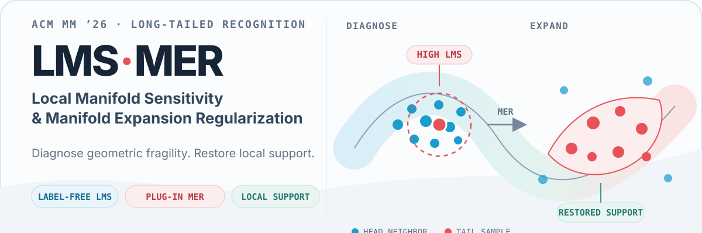
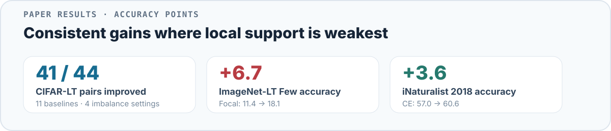
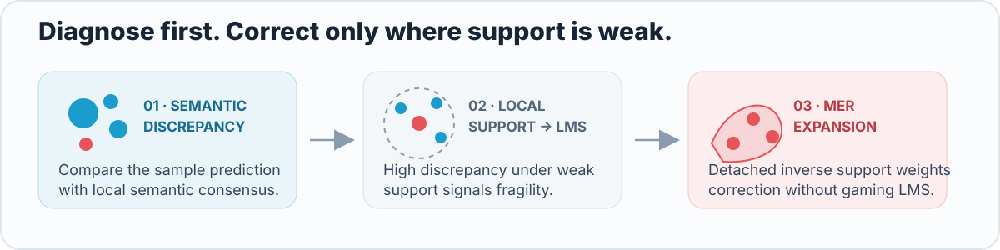

<p align="center">
  
</p>

<p align="center">
  <a href="#results">Results</a> ·
  <a href="#how-it-works">How it works</a> ·
  <a href="#quick-start">Quick start</a> ·
  <a href="#configuration">Configuration</a>
</p>

**LMS-MER** is a diagnose-then-correct framework for long-tailed recognition. **Local Manifold Sensitivity (LMS)** identifies samples whose semantic behavior is unstable relative to their local structural support. **Manifold Expansion Regularization (MER)** then applies stronger correction in those fragile regions while leaving well-supported regions largely undisturbed.

> **Repository scope.** This release currently focuses on the **CIFAR-10-LT and CIFAR-100-LT training pipeline**. The paper additionally evaluates ImageNet-LT and iNaturalist 2018.

## Why LMS-MER?

- **Label-free diagnosis:** LMS measures geometric fragility online without using class-frequency labels.
- **Support-aware correction:** MER weights semantic correction using detached inverse structural support.
- **Drop-in regularization:** MER can augment diverse long-tailed objectives without changing their backbone or training protocol.

<a id="results"></a>
## Results

<p align="center">
  
</p>

<details>
<summary><strong>Full CIFAR-LT comparison</strong></summary>

<br>

| Method | C10-LT-50 Raw | +MER | Δ | C10-LT-100 Raw | +MER | Δ | C100-LT-50 Raw | +MER | Δ | C100-LT-100 Raw | +MER | Δ |
| --- | ---: | ---: | ---: | ---: | ---: | ---: | ---: | ---: | ---: | ---: | ---: | ---: |
| CE | 78.5 | 80.3 | **+1.8** | 73.0 | 74.6 | **+1.6** | 44.6 | 47.4 | **+2.8** | 39.2 | 43.4 | **+4.2** |
| Focal Loss | 78.4 | 79.3 | **+0.9** | 72.7 | 74.6 | **+1.9** | 42.6 | 46.5 | **+3.9** | 38.8 | 41.4 | **+2.6** |
| IB | 81.7 | 82.7 | **+1.0** | 75.1 | 77.5 | **+2.4** | 46.3 | 47.9 | **+1.6** | 40.6 | 42.0 | **+1.4** |
| LA | 81.5 | 83.1 | **+1.6** | 78.6 | 79.0 | **+0.4** | 48.6 | 46.5 | −2.1 | 44.2 | 42.1 | −2.1 |
| KPS | 84.2 | 85.1 | **+0.9** | 82.2 | 83.3 | **+1.1** | 47.7 | 48.7 | **+1.0** | 41.7 | 44.4 | **+2.7** |
| Mixup | 79.5 | 81.1 | **+1.6** | 73.9 | 74.9 | **+1.0** | 46.4 | 47.7 | **+1.3** | 40.8 | 43.5 | **+2.7** |
| GLMC | 86.7 | 88.1 | **+1.4** | 84.3 | 85.5 | **+1.2** | 58.7 | 60.2 | **+1.5** | 54.0 | 55.4 | **+1.4** |
| SupCon | 78.7 | 80.6 | **+1.9** | 72.0 | 76.0 | **+4.0** | 43.4 | 47.3 | **+3.9** | 39.2 | 43.3 | **+4.1** |
| ProCo | 88.2 | 89.0 | **+0.8** | 85.8 | 86.5 | **+0.7** | 55.7 | 56.7 | **+1.0** | 51.2 | 52.5 | **+1.3** |
| SHIKE (w/o cRT) | 82.7 | 85.1 | **+2.4** | 77.9 | 81.8 | **+3.9** | 52.7 | 57.2 | **+4.5** | 47.7 | 51.6 | **+3.9** |
| SHIKE (with cRT) | 86.7 | 87.5 | **+0.8** | 84.4 | 85.5 | **+1.1** | 59.5 | 60.3 | **+0.8** | 55.9 | 55.7 | −0.2 |

</details>

<a id="how-it-works"></a>
## How it works

<p align="center">
  
</p>

LMS is used as a **diagnostic signal**, not optimized directly. MER keeps the semantic discrepancy term differentiable while detaching the inverse-support weight. This prevents the model from reducing the loss by manipulating the support estimator instead of correcting fragile decision geometry.

<a id="quick-start"></a>
## Quick start

### 1. Install

```bash
pip install torch torchvision numpy matplotlib tqdm nni
```

Recommended environment: Python 3.9+ and PyTorch 2.x.

### 2. Train a baseline

```bash
python main.py --method ce --dataset cifar100 --imb_factor 100
```

### 3. Train MER

```bash
python main.py --method mer --dataset cifar100 --imb_factor 100 --mer_k 5
```

### 4. Add MER to another objective

```bash
python main.py \
  --method la \
  --mer \
  --lambda_mer 0.6 \
  --dataset cifar100 \
  --imb_factor 100
```

## Repository map

| Path | Purpose |
| --- | --- |
| `main.py` | Training, evaluation, CIFAR-LT construction, baseline selection, and MER integration |
| `loss/merloss.py` | MER loss and feature-space expansion components |
| `utils/lms_recorder.py` | Online LMS computation, queue-augmented statistics, and snapshot export |
| `models/MyResnet.py` | Backbone wrappers for ResNet, DenseNet, MobileNetV2, and VGG16 |

<a id="configuration"></a>
## Configuration

### Supported methods

`ce` · `mixup` · `la` · `focal` · `ldam` · `scl` · `mer` · `crt`

### Important options

| Option | Description |
| --- | --- |
| `--dataset` | `cifar10` or `cifar100` |
| `--imb_factor` | Long-tail imbalance factor |
| `--backbone` | `resnet32`, `resnet18`, `resnet50`, `densenet121`, `mobilenet_v2`, or `vgg16` |
| `--mer` | Add MER as an auxiliary regularizer |
| `--lambda_mer` | MER loss weight |
| `--mer_k` | Neighborhood size for LMS/MER |
| `--mer_margin` | Margin used by feature-expansion components |

Method-specific options include `--mixup_alpha`, `--la_tau`, `--focal_gamma`, `--ldam_max_m`, `--ldam_s`, `--scl_lambda`, `--scl_temp`, and `--rt_start`.

## Outputs

Training artifacts are written to `--save_dir` (default: `results_ce_bs/`). The default LMS recorder exports:

```text
lms_full_snapshot.npz
```

`utils/lms_recorder.py` also contains `LMSRecorder`, which can export additional diagnostic plots, but it is not the default path in `main.py`.

## Reproducibility

- Random seeds are set through `utils/utils.py::set_seed`.
- Deterministic CuDNN behavior is enabled by the seed utility.
- For strict reproduction, match the CUDA/cuDNN versions, GPU type, data-loading behavior, AMP settings, and the complete experiment configuration used in the paper.