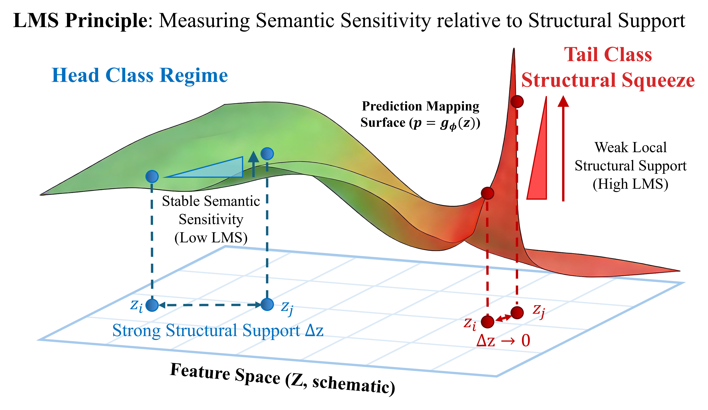
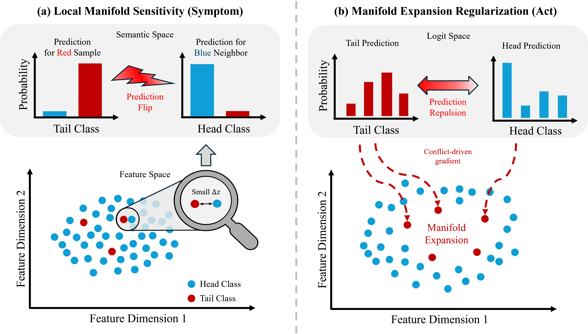

# Local Manifold Sensitivity and Regularization in Long-Tailed Recognition


This repository provides the anonymous implementation for our long-tailed recognition framework based on **Local Manifold Sensitivity (LMS)** and **Manifold Expansion Regularization (MER)**.

In long-tailed recognition, performance degradation is not only caused by class imbalance itself, but also by **structural squeeze** in the learned feature space: tail samples are often embedded in densely populated head-class neighborhoods with weak local structural support. Our method addresses this problem with a diagnose-then-correct pipeline:

- **LMS**: an online, label-free diagnostic that measures semantic discrepancy relative to local structural support.
- **MER**: a support-aware regularization term that applies stronger corrective pressure in weakly supported regions and progressively restores collapsed local manifolds.

The paper shows that LMS consistently reveals the structural fragility of tail classes, and that MER improves a broad range of long-tailed baselines across diverse settings. 



---

## Overview

This codebase currently focuses on the **CIFAR-LT training pipeline**, together with:

- LMS recording and analysis utilities
- MER loss integration
- multiple long-tailed baselines under a unified training framework
- optional extensions to alternative backbones

The main entry point is:

- `main.py`

Main modules:

- `main.py`  
  Training, evaluation, long-tailed CIFAR data construction, baseline selection, and MER integration.

- `loss/merloss.py`  
  Implementation of **MERLoss** and feature-space expansion related components.

- `utils/lms_recorder.py`  
  **LMSMemoryRecorder** for online LMS computation, queue-augmented statistics recording, and snapshot export.

- `models/MyResnet.py`  
  Backbone wrapper for `resnet18`, `resnet50`, `densenet121`, `mobilenet_v2`, and `vgg16`.

---

## Method Summary

### Local Manifold Sensitivity (LMS)

For each sample, LMS builds a local feature-space neighborhood, computes a neighborhood-induced semantic consensus, and measures how much the current prediction deviates from that consensus relative to the available structural support. In the paper, LMS is defined as the ratio between:

- a **semantic discrepancy** term
- and a **local structural support** term

so that high LMS indicates that a sample exhibits disproportionately unstable semantic behavior under weak local support. LMS is used as a **diagnostic signal**, not as a direct optimization target.

### Manifold Expansion Regularization (MER)

MER converts the fragility diagnosed by LMS into a training signal. Instead of directly optimizing the LMS ratio, MER keeps the semantic discrepancy term active while using inverse structural support only as a detached weighting factor. This design prevents the model from “gaming” the support estimator and instead encourages genuine correction of fragile local regions. In practice, MER is a lightweight auxiliary loss that can be plugged into multiple long-tailed training objectives.


---

## What This Repository Supports

### Baselines

The training framework includes multiple long-tailed baselines such as:

- CE
- Mixup
- LA
- Focal Loss
- LDAM
- RW / DRW
- Resample
- SCL
- CRT

### MER Usage Modes

MER can be used in two ways:

1. **Standalone method**
2. **Auxiliary regularizer** on top of another baseline

### LMS Recording

The repository also supports online LMS analysis, including:

- epoch-wise LMS statistics
- per-class LMS summaries
- correlation curves between LMS and class frequency
- full snapshot export for later analysis

The paper shows that LMS exhibits a consistent emergence pattern across methods, architectures, and datasets, which supports its role as a model-agnostic indicator of long-tailed training dynamics.

---

## Environment

Recommended environment:

- Python 3.9+
- PyTorch 2.x
- torchvision
- numpy
- matplotlib
- tqdm
- nni

Example installation:

```bash
pip install torch torchvision numpy matplotlib tqdm nni
```

If you do not use NNI-based tuning, you may remove the related dependency or adapt the corresponding import in `main.py`.

---

## Quick Start

### Train a CE baseline

```bash
python main.py --method ce --dataset cifar100 --imb_factor 100
```

### Train MER as the main method

```bash
python main.py --method mer --dataset cifar100 --imb_factor 100 --mer_k 5
```

### Add MER on top of another method

Example: LA + MER

```bash
python main.py --method la --mer --lambda_mer 0.6 --dataset cifar100 --imb_factor 100
```

### Train CRT

```bash
python main.py --method crt --rt_start 180 --dataset cifar100 --imb_factor 100
```

---

## Important Arguments

### General

- `--dataset`: `cifar10` or `cifar100`
- `--imb_factor`: long-tail imbalance factor
- `--epochs`
- `--batch_size`
- `--lr`
- `--seed`
- `--backbone`: `resnet32`, `resnet18`, `resnet50`, `densenet121`, `mobilenet_v2`, `vgg16`

### Method Selection

- `--method`: `ce`, `mixup`, `la`, `focal`, `ldam`, `rw`, `drw`, `resample`, `scl`, `mer`, `crt`

### MER / LMS

- `--mer`: enable MER as an auxiliary regularizer
- `--lambda_mer`: weight of MER
- `--mer_k`: neighborhood size used in MER/LMS
- `--mer_margin`: margin used in feature expansion related computations

### Other Method-Specific Arguments

- `--mixup_alpha`
- `--la_tau`
- `--focal_gamma`
- `--ldam_max_m`
- `--ldam_s`
- `--rw_beta`
- `--drw_start_epoch`
- `--scl_lambda`
- `--scl_temp`
- `--rt_start`

---

## Outputs

Training outputs are written to `--save_dir` (default: `results_ce_bs/`).

With the default `main.py` pipeline (`LMSMemoryRecorder`), the LMS artifact is:

- `lms_full_snapshot.npz`

Note: `utils/lms_recorder.py` also contains `LMSRecorder`, which can export additional PNG plots,
but that recorder is not the default path in `main.py`.

---

## Main Results

### Baselines

Comparisons between baseline methods and their MER-enhanced counterparts on CIFAR-LT datasets.

| Method | CIFAR-10-LT-50 Raw | CIFAR-10-LT-50 MER | CIFAR-10-LT-50 Incr | CIFAR-10-LT-100 Raw | CIFAR-10-LT-100 MER | CIFAR-10-LT-100 Incr | CIFAR-100-LT-50 Raw | CIFAR-100-LT-50 MER | CIFAR-100-LT-50 Incr | CIFAR-100-LT-100 Raw | CIFAR-100-LT-100 MER | CIFAR-100-LT-100 Incr |
| --- | ---: | ---: | ---: | ---: | ---: | ---: | ---: | ---: | ---: | ---: | ---: | ---: |
| CE | 78.5 | 80.3 | +1.8 | 73.0 | 74.6 | +1.6 | 44.6 | 47.4 | +2.8 | 39.2 | 43.4 | +4.2 |
| Focal Loss | 78.4 | 79.3 | +0.9 | 72.7 | 74.6 | +1.9 | 42.6 | 46.5 | +3.9 | 38.8 | 41.4 | +2.6 |
| IB | 81.7 | 82.7 | +1.0 | 75.1 | 77.5 | +2.4 | 46.3 | 47.9 | +1.6 | 40.6 | 42.0 | +1.4 |
| LA | 81.5 | 75.7 | -5.8 | 78.6 | 70.6 | -8.0 | 48.5 | 43.4 | -5.1 | 42.8 | 37.6 | -5.2 |
| KPS | 84.2 | 85.1 | +0.9 | 82.2 | 83.3 | +1.1 | 47.7 | 48.7 | +1.0 | 41.7 | 44.4 | +2.7 |
| Mixup | 79.5 | 81.1 | +1.6 | 73.9 | 74.9 | +1.0 | 46.4 | 47.7 | +1.3 | 40.8 | 43.5 | +2.7 |
| GLMC | 86.7 | 88.1 | +1.4 | 84.3 | 85.5 | +1.2 | 58.7 | 60.2 | +1.5 | 54.0 | 55.4 | +1.4 |
| SupCon | 78.7 | 80.6 | +1.9 | 72.0 | 76.0 | +4.0 | 43.4 | 47.3 | +3.9 | 39.2 | 43.3 | +4.1 |
| ProCo | 88.2 | 89.0 | +0.8 | 85.8 | 86.5 | +0.7 | 55.7 | 56.7 | +1.0 | 51.2 | 52.5 | +1.3 |
| SHIKE (w/o cRT) | 83.4 | 85.8 | +2.4 | 79.3 | 81.8 | +2.5 | 52.7 | 57.0 | +4.3 | 47.6 | 52.0 | +4.4 |
| SHIKE | 87.0 | 87.6 | +0.6 | 84.8 | 84.2 | -0.6 | 59.3 | 60.0 | +0.7 | 55.4 | 55.6 | +0.2 |

Note: Reproduction in this repository depends on matching the full experimental protocol and configuration.

---

## Reproducibility Notes

- Random seeds are set through `utils/utils.py::set_seed`.
- Deterministic CuDNN behavior is enabled in the seed utility.
- For strict reproducibility, please verify:
  - CUDA / cuDNN version
  - GPU type
  - data loading behavior
  - AMP settings

